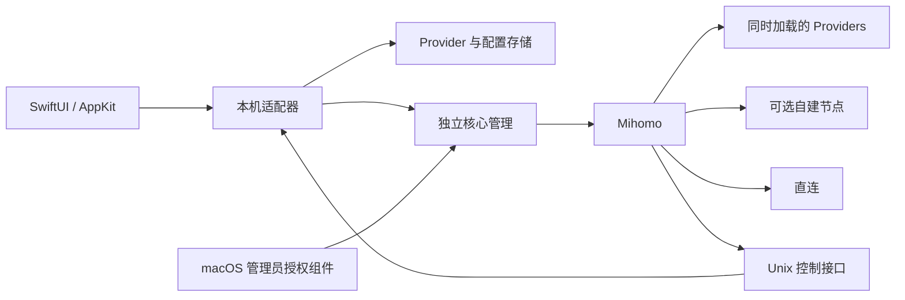

# AX1OM Network 架构

AX1OM Network 是原生 macOS 客户端，围绕 Mihomo 建立节点来源、业务编排、运行控制与状态展示。界面与网络核心分离，公开源码不包含私人节点或订阅。

## 组件

| 层 | 职责 |
| --- | --- |
| 原生界面 | 控制台、订阅、节点、编排、连接、用量和检测 |
| 内置 Node.js 适配器 | 校验输入、转换配置、读取状态、执行限定操作 |
| Provider 存储 | 来源身份、节点缓存、额度元数据和私有认证 |
| Mihomo | 规则匹配、节点连接、DNS、TUN 和运行接口 |
| 授权启动组件 | 通过 Authorization Services 执行限定的 TUN 启停 |
| 用量账本 | 基于已观察字节差量保存日汇总与业务分布 |

Node.js 是本机后台运行组件，不承载 HTML 界面。发行应用内置运行库；旧版 Relay 与 Clash Verge 仅能作为显式导入或审计来源，不是正常运行的依赖。

## 节点来源与策略

每个 HTTP 或本地来源拥有稳定标识和独立缓存文件。只导入节点，不把来源订阅的规则、DNS 或代理组无条件合并到正式配置。节点显示名称使用来源前缀，降低跨订阅重名冲突。

业务组通过 Provider 引用同时可见的节点。来源更新使用核心 Provider 接口，节点选择使用对应策略组接口，不因更新一份订阅重启整个核心。节点变动可能影响原选择与连接；目前不承诺跨更新保持任何任意会话。

宽泛分类之前保留局域网、Tailscale 和显式直连例外；具体应用规则优先于通用服务分类；最终未命中流量由默认出口接收。自建节点与主备策略来自用户自己的配置，不随发行包附送。

## 独立运行与迁移

正式配置默认启用 TUN。独立测试使用单独配置关闭 TUN，仅提供 `127.0.0.1:17901` HTTP / SOCKS 回环代理入口，不修改系统代理或默认路由。正式 TUN 配置使用回环混合端口 `18081` 和 DNS 端口 `18082`。状态适配器优先读取独立核心的实际控制元数据与活动配置，避免把准备中的 TUN 配置误报为已启用。

启动 TUN 需要管理员授权，并检查旧 Clash Verge 核心是否仍在运行。它不会自动停止旧代理。部署应确保只有一个客户端负责透明流量接管，具体切换与回退步骤见 [MIGRATION.md](MIGRATION.md)。

## 控制接口与敏感数据

控制接口使用本机 Unix socket 和随机密钥。状态读取与写入操作分开；终结连接前会重新确认单个连接标识，不能把单连接请求扩大成清空所有连接。节点切换、Provider 更新与配置重新载入只发往 AX1OM 自己的控制接口。

敏感数据保存在应用支持目录。缓存和备份含实际认证，不能作为调试附件直接发布。应用的脱敏快照与接口错误不回传原始认证内容。

## 统计与检测口径

流量统计使用核心累计计数与连接差量。首次采样没有历史补录，应用关闭、读取异常与较长采样间隔也不估算空白。跨午夜的已观察采样按时间比例分配；按业务和节点归属只统计可关联的连接变化，其余单列未归属。节点归属来自实际连接链路，不使用编排中的目标节点倒推；本机采样记录与服务商订阅额度分开显示。采样盲区、已结束且未捕获的短连接和未确定出口的链路不伪造节点用量。账本格式 v2 可读取旧 v1 日汇总；旧记录没有实际出口节点证据时保留为未归属，不用当前策略补造历史。

IP 检测使用手动请求的实际响应；请求出口不自动等同于任意登录、API 或浏览器会话的出口。DNS 查询仅说明当前解析器和指定问题的响应，不证明所有域名都采用相同行为。第三方信誉评分不是业务提供商的官方判断。

## 当前边界

v0.1.0 已提供独立组件与软件测试路径，但真实 TUN 接管、长期运行、睡眠唤醒、网络切换和各业务长连接仍需实际验收。管理员启动组件使用临时签名，尚未取得 Developer ID 与 Apple 公证。该状态属于预发布边界，不应将隔离测试结果写成生产接管成功。
